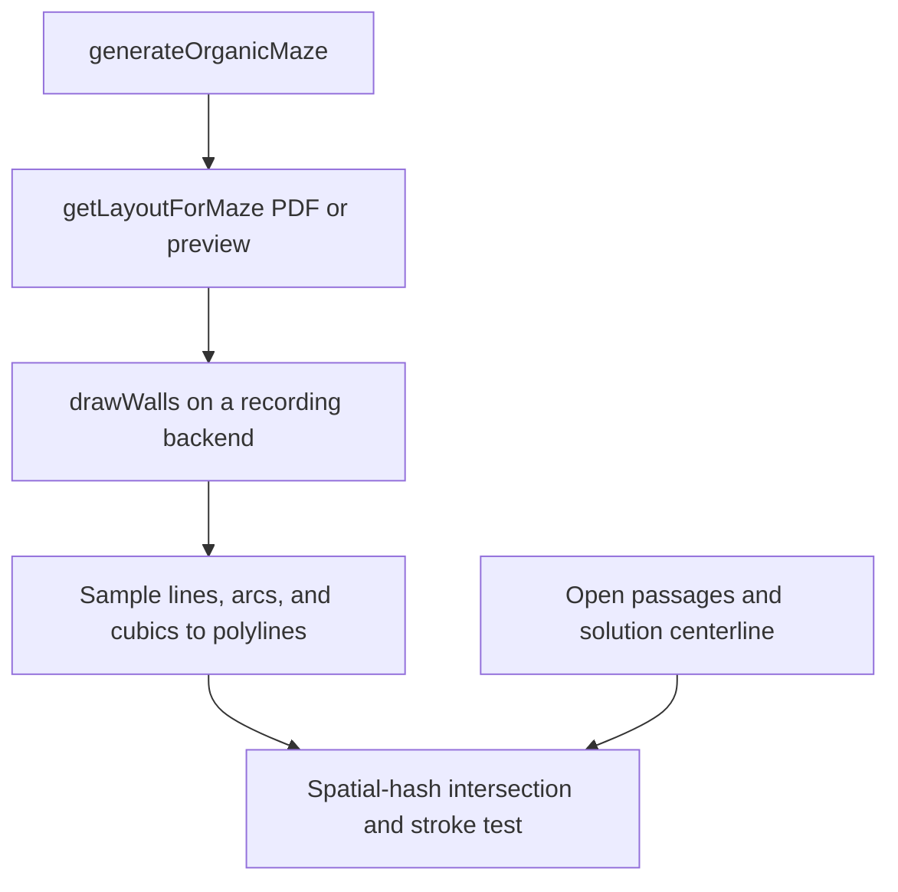

# Plan: Organic wall overlap tests

**Status:** done
**Last updated:** 2026-11-27
**Owner:** agent
**Related:** `docs/DECISIONS.md#D-023`, PR #8 (Curvy bow)

---

## Overview

Add automated tests that record the wall strokes Jagged and Curvy actually draw for the PDF page and the sample-preview canvas, then flag crossings, collinear overlaps, stroke-width merges, and walls that cover a passage or the solution. Generator bugs stay unfixed. Cases that overlap are expected failures so `npm test` stays green.

## Scope

**In scope:**

- Jagged at Hard, Challenging, Difficult, and Epic Adventure
- Curvy at every level, including the bowed walls from D-023
- At least 20 seeds per level, plus the deterministic sample-preview seed
- PDF layout and the 560×720 preview layout used by Generate mode
- Stroke width, so outlined walls count as overlapping when centerlines are closer than the stroke
- A written tolerance definition, a pass/fail table, and a picture of a reproduced failure

**Out of scope:**

- Fixing generator or drawer bugs
- UI, layout, or style files (another branch owns that work)
- Classic, Circular, and Squares
- Merging the PR

---

## Architecture



**Files touched:**

- `tests/wall-overlap-geometry.js` — tolerances, recording backend, intersection checks, SVG/PNG evidence
- `tests/organic-wall-sweep.js` — seed sweep over the real drawers
- `tests/organic-wall-overlap.test.js` — synthetic detector tests plus the sweep
- `.cursor/plans/organic_wall_overlap_tests.plan.md`

**Key interfaces / contracts:**

- Drawers are called unchanged. The recording backend implements the same draw calls as the PDF and canvas backends.
- A shared endpoint within `endpointEps` is a join, not an overlap.
- Centerline distance `< (w1 + w2) / 2` is a stroke overlap. Equal distance (ink that only touches) is not.

---

## Checkpoints

- **C0** — Overlap detector, sweep, and draft PR with the failure report

---

## Validation

**Tests to add/update:**

- Synthetic joins, crossings, collinear duplicates, stroke-width merges, and blocked passages
- Sweep: Jagged (4 levels) and Curvy (7 levels), PDF and preview, 20+ seeds

**Commands to run:**

```bash
npm test
npm run build
```

**Pass criteria:**

- `npm test` exits 0. Known overlaps are `it.fails` and still execute.
- `npm run build` exits 0.
- The PR body lists tolerances, the pass/fail table, and every failing style, level, seed, and overlap kind.

---

## Notes / Risks

- Sharp miters and the entrance jamb meet on purpose. The checker must not treat those joins as crossings.
- Curvy bows and filler corridors are the likely source of real overlaps. Those stay as expected failures.
- Do not edit UI files.

---

## Retrospective (fill after checkpoints)

**What worked:**

- Recording the real drawer calls catches the closed loops and pinched passages visible in the sample preview.
- Round-cap miters stay out of the failure list. Interior crossings and stroke-width merges stay in.

**What didn't work:**

- A first pass treated every near-miss miter as an overlap. The miter ball removed those without hiding the real crossings.

**Gaps identified:**

- The generator still draws overlapping Jagged and Curvy walls. This plan does not change it.

**Lessons learned:**

- Yield between seeds so a long sweep does not block Vitest’s worker heartbeat.

---

**Next review:** after the sweep report is in the PR
