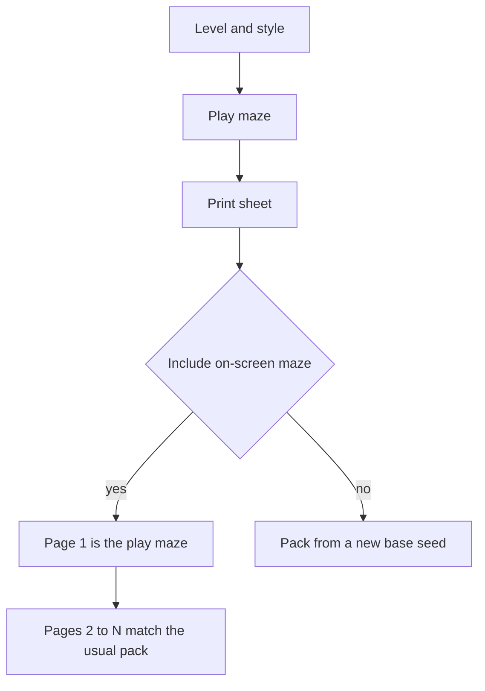

# Plan: Play-first screen and print sheet

**Status:** done
**Last updated:** 2026-11-28
**Owner:** agent
**Related:** `docs/DECISIONS.md#D-028`

---

## Overview

The page opens on a playable maze. Level and style are remembered locally. Print opens a sheet with the quantity control and an option to put the on-screen maze on page 1 of the same PDF pack.

## Scope

**In scope:**

- Remove the Print/Play toggle. Play is the only screen.
- First visit: Easy and Classic. Later visits: last level and style from `localStorage`.
- Level or style change, and New maze, roll a new playable maze. Hint, Start over, and line forgiveness stay.
- Print sheet with quantity and “Include the maze on screen” (default on). Page 1 is that maze’s object. Other pages match today’s pack.
- D-028. Vitest coverage for preferences, reseed rules, and the included seed/geometry.

**Out of scope:**

- Answer keys. None exist outside debug, and debug solution overlay stays debug-only.
- A coarser play grid for Epic.
- Persisting seeds, strokes, forgiveness, or quantity.
- Restyling the page beyond the sheet and the removed toggle.

---

## Architecture (optional)



**Files touched:**

- `src/index.html`
- `src/main.js`
- `src/play/ui.js`
- `src/play/config.js`
- `src/settings/preferences.js`
- `src/print/pack.js`
- `src/styles/main.css`
- `tests/play-first.test.js`
- `docs/DECISIONS.md`
- `README.md`
- `e2e/generate-pdf.spec.js`

**Key interfaces / contracts:**

- `loadPlayPreferences` / `savePlayPreferences` store only `{ ageRange, mazeStyle }`.
- `playSessionPlan` rolls a seed for a level change, a style change, New maze, and solve. Start over does not.
- `assemblePrintPack` with `includeCurrent` replaces page 1 with the play maze and leaves later pages on the same base seed as a pack that does not include it.

---

## Checkpoints

- **C0** — Branch from merged `main` (PR #13).
- **C1** — Preferences, reseed plan, and print pack, with tests.
- **C2** — Play-first markup, sheet, and phone/desktop layout kept from D-025 and D-027.
- **C3** — Decision, README, full Vitest run, production build, screenshots.

---

## Validation

**Tests to add/update:**

- Empty or invalid storage returns Easy and Classic. A round trip stores only level and style.
- A level or style change, and New maze, request a new seed. The same key with a non-roll reason keeps the seed.
- Included page 1 is the play maze. Its seed regenerates the same classic geometry. Later pages match the pack built without that option.

**Commands to run:**

```bash
npm test
npm run build
```

**Pass criteria:**

- Vitest passes, including the new cases.
- Production build succeeds.
- 412×915 shows a playable maze on first load, a new maze after a level change, and the print sheet. A desktop width shows the same screen.

---

## Notes / Risks

- v0 said the app was stateless. D-028 is the exception, and it is limited to level and style.
- Debug “1 of each” packs do not swap in the on-screen maze.
- There is no answer-key control to move into the sheet.

---

## Retrospective (fill after checkpoints)

**What worked:**

- Page 1 of the pack is the play maze object, so the seed and geometry cannot drift.
- The phone frame and width-fit stayed in place because play is always the screen.

**What didn't work:**

- A full Vitest run once reported a curvy PDF byte mismatch. The same test passed immediately afterward, and the next full run passed. The renderer was not changed.

**Gaps identified:**

- On a phone, Print sits under the style chips, so the default Easy maze can push it just past the first screen. The page scrolls.

**Lessons learned:**

- There is no answer-key control to move. Solution drawings stay in debug mode.

---

---

**Next review:** after the draft PR is open
