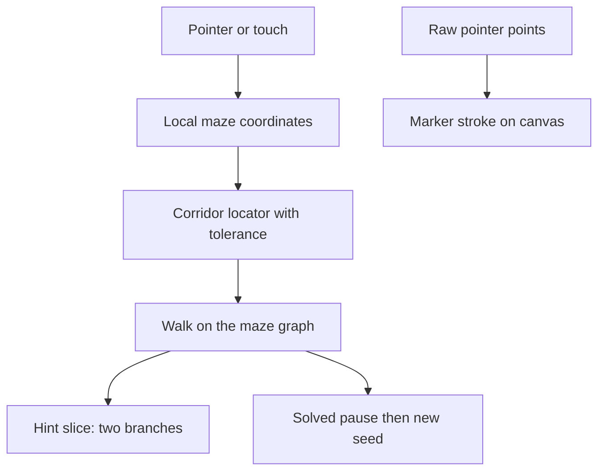

# Plan: Playable maze

**Status:** done
**Last updated:** 2026-10-11
**Owner:** agent
**Related:** `docs/DECISIONS.md#D-020`

---

## Overview

The printable generator stays as it is. A Play mode on the same page uses the selected level and style to generate one maze the player solves with a mouse or finger. Nothing is saved. No logins, scores, or accounts.

## Scope

**In scope:**

- Play / Print mode switch on the existing page
- One maze for the selected level and style (Classic, Jagged, Curvy, Circular, Squares)
- Freehand marker stroke drawn where the pointer actually went
- Wall forgiveness per difficulty, adjustable while testing, held in memory only
- Start over clears the stroke and keeps the same seed
- Hint overlays the solution from the furthest correct cell through the next two branch decisions
- On solve: still “Solved” message, short pause, new seed, same level and style
- Unit tests for tracing, forgiveness, hint length, and each layout

**Out of scope:**

- Saved games, stats, accounts, leaderboards
- Animations, confetti, or sound
- Changing PDF generation, maze algorithms, or print layout
- Persistence of forgiveness settings

---

## Architecture



**Files touched:**

- `src/play/trace.js` — progress, backtracking, hint slice
- `src/play/locate.js` — grid, organic, and polar point classification
- `src/play/model.js` — topology and layout mapping, including Squares rooms
- `src/play/session.js` — strokes, replay when forgiveness changes, clear
- `src/play/view.js` — marker and hint drawing, pointer mapping
- `src/play/ui.js` — mode, canvas, buttons
- `src/utils/constants.js` — default forgiveness per level
- `src/index.html`, `src/styles/main.css`, `src/main.js`
- `tests/play.test.js`
- `docs/DECISIONS.md`

**Key interfaces / contracts:**

- Forgiveness is a fraction of the local corridor. `0.30` means a stroke may pass 30% of a corridor width beyond a wall and still count as that corridor.
- A branch decision is a cell with three or more open passages. The hint includes the correct step out of the second branch.
- Furthest correct cell only moves forward along the solution. A dead-end excursion does not move it. Hint starts there.
- Logical steps follow open passages only. Ink is stored as drawn and is not snapped to cell centers.
- Same seed and settings rebuild the same maze. A new seed is chosen only for a new play or after a solve, via the existing `generateSeed()` used for PDFs.

---

## Checkpoints

- **C0** — Plan and decision D-020
- **C1** — Trace, locators, session, and unit tests
- **C2** — Play mode UI, mobile layout, browser check

---

## Validation

**Tests to add/update:**

- `tests/play.test.js`

**Commands to run:**

```bash
npm test
```

**Pass criteria:**

- Hint from a known junction covers exactly two branches plus the exit step
- A dead-end keeps the furthest correct cell at the junction
- Points within forgiveness stay in the corridor; points past it do not cross a wall
- Walking cell centers solves Classic, Jagged, Circular, and Squares for a fixed seed
- Start over clears progress and keeps the solution
- `npm test` passes

---

## Notes / Risks

- Squares rooms are expanded into their sub-mazes so the player traces through the room instead of jumping openings.
- Decorative organic filler is not part of the playable graph.
- Celebration is a still message. No motion.

---

## Retrospective (fill after checkpoints)

**What worked:**

- `npm test` — 214 passed, including `tests/play.test.js` (18).
- Browser check: Play hides print controls, the marker follows the pointer, Hint draws the next turns, Start over clears the same maze, and a narrow window stacks the maze above the controls.

**What didn't work:**

- The first play canvas was transparent, so the faint page pattern showed through. The play surface is now filled with the page color before the walls are drawn.

**Gaps identified:**

- Forgiveness defaults are starting points. The slider is there so each level can be dialed in by hand.

**Lessons learned:**

- Squares play has to walk each room’s sub-maze. The outer solver path jumps the openings.

---

**Next review:** after tests and browser check
